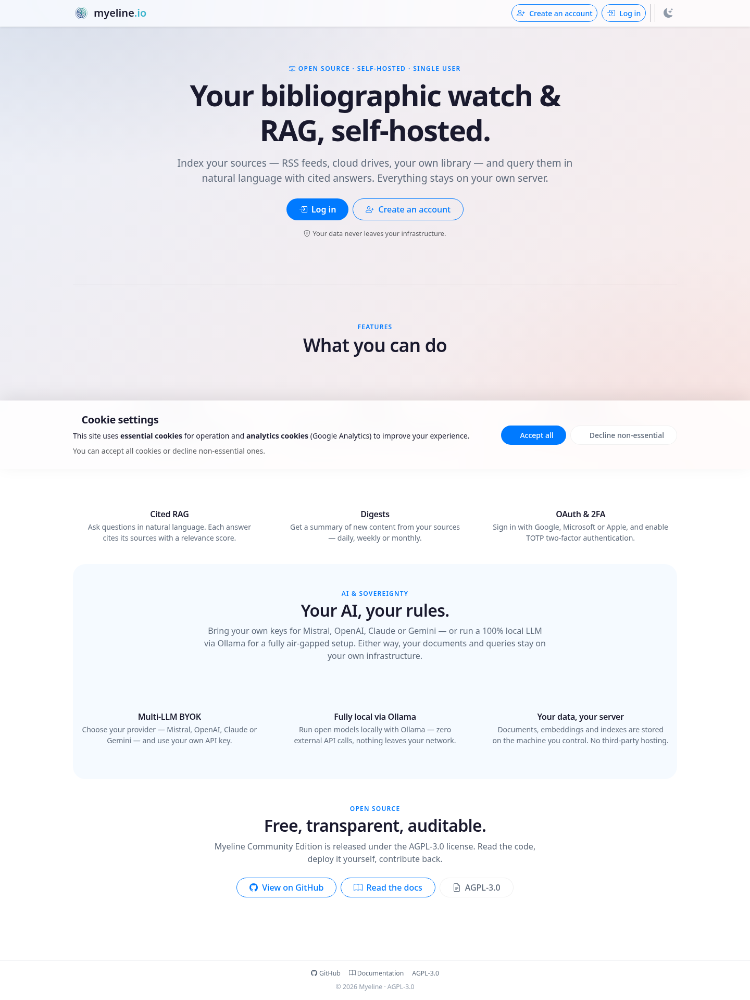
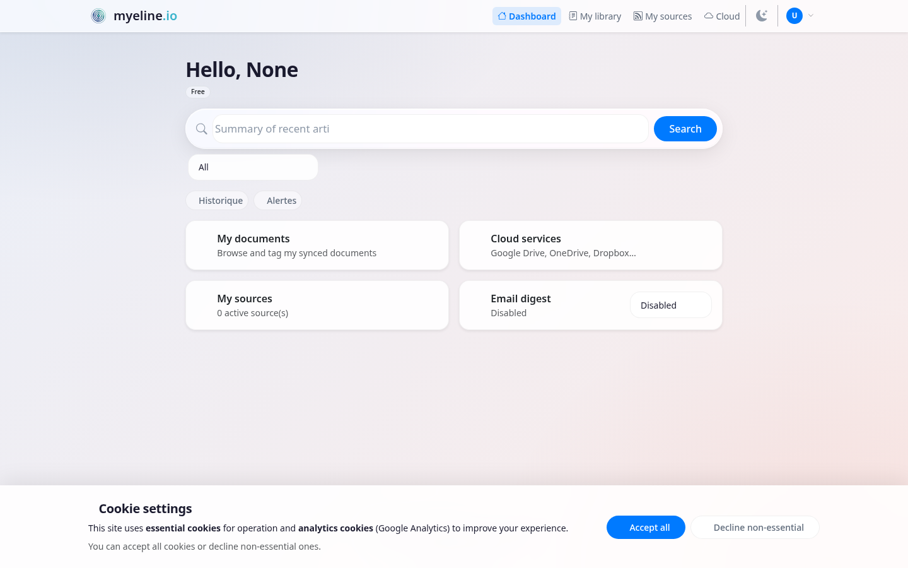
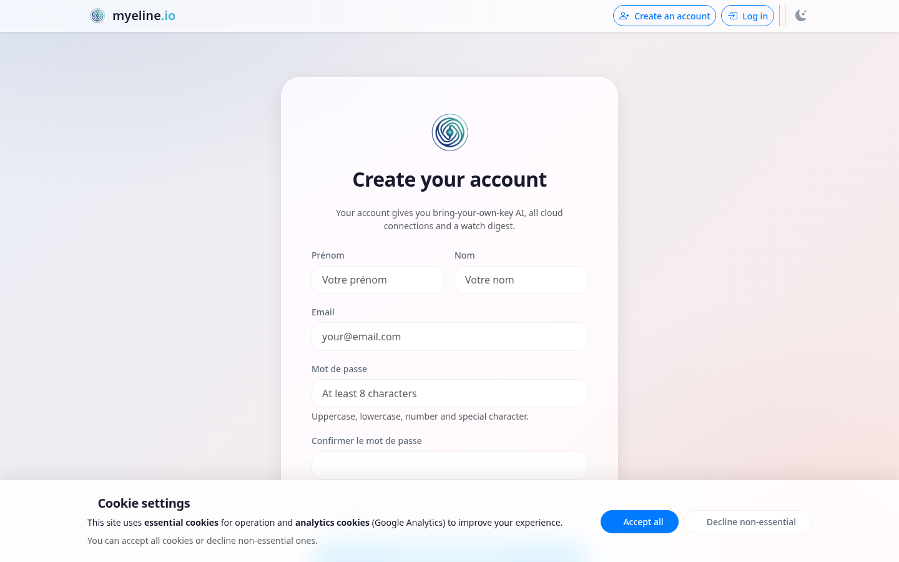

<div align="center">

# 🧠 Myeline

### Sovereign bibliographic watch & RAG over your own sources

**Self-hosted. Single-user. Your data never leaves your server.**

Index your RSS feeds, cloud documents and personal library into a local vector
store, then ask questions in natural language and get answers grounded in *your*
material — with citations. Bring your own LLM key, or run the model 100% locally
with Ollama.

[](LICENSE)
[](https://www.python.org/)
[](https://github.com/ClaraVnk/myeline/actions/workflows/ci.yml)
[](.github/workflows/ci.yml)
[](https://podman.io/)
[](CONTRIBUTING.md)
[](https://wiki.myeline.io/editions/community/)

[Why](#-why-myeline) ·
[Features](#-features) ·
[Quickstart](#-quickstart) ·
[Configuration](#%EF%B8%8F-configuration) ·
[Architecture](#%EF%B8%8F-architecture) ·
[Troubleshooting](#-troubleshooting) ·
[FAQ](#-faq) ·
[Contributing](#-contributing) ·
[Wiki](https://wiki.myeline.io/editions/community/)

</div>

---

<div align="center">
  
  <br>
  <sub><i>Self-hosted landing — your own instance, your data, your LLM.</i></sub>
  <br><br>
  
  &nbsp;
  
  <br>
  <sub><i>Dashboard · account creation</i></sub>
</div>

---

## Table of contents

- [Why Myeline](#-why-myeline)
- [What it is](#-what-it-is)
- [Features](#-features)
- [Quickstart](#-quickstart)
- [Configuration](#%EF%B8%8F-configuration)
- [Bring your own OAuth app](#-bring-your-own-oauth-app)
- [Architecture](#%EF%B8%8F-architecture)
- [Multi-LLM (BYOK) & self-hosted models](#-multi-llm-byok--self-hosted-models)
- [Troubleshooting](#-troubleshooting)
- [FAQ](#-faq)
- [Contributing](#-contributing)
- [Security](#-security)
- [Open-core](#-open-core)
- [License](#-license)
- [Acknowledgements](#-acknowledgements)

---

## 💡 Why Myeline

Most "chat with your documents" tools ship your corpus to a third party and bill
you per token. Myeline is the opposite bet:

- **Your data stays home.** Documents, vector index and conversation history live
  on *your* server. The only outbound calls are to whichever LLM provider you
  choose — and you can remove those entirely.
- **Sovereign RAG.** Run embedding *and* synthesis fully offline with a local
  [Ollama](https://ollama.com) model. No API key, no egress, air-gap friendly.
- **No lock-in on the model.** Bring your own key for Mistral, OpenAI, Anthropic
  Claude or Google Gemini — switch any time from the UI.
- **Answers you can trust.** Every response carries clickable `[N]` citations
  that scroll to the exact passage they came from.
- **Boring, auditable stack.** Flask, MariaDB, Redis, ChromaDB, Ollama — all in
  a hardened Podman/Docker compose you fully control.

---

## 📖 What it is

Myeline is a Retrieval-Augmented Generation (RAG) layer over your personal
corpus. You connect sources; Myeline scrapes, parses and embeds their content
into [ChromaDB](https://www.trychroma.com/); at query time it retrieves the most
relevant passages and hands them to an LLM of your choice to synthesise a cited
answer.

This repository is the **open-source, self-host edition** (AGPL-3.0). It runs
entirely on your own infrastructure and is designed for a single user. The UI
ships in **French** and **English**, with a dark/light theme. See
[Open-core](#-open-core) for how it relates to the hosted edition.

---

## ✨ Features

| | |
|---|---|
| ☁️ **Cloud connectors** | Sync & index files from Google Drive, OneDrive, Dropbox, kDrive (Infomaniak), S3 / S3-compatible (Scaleway, OVH, R2, MinIO…), WebDAV, Notion and Zotero — each with **your own** credentials. |
| 📰 **RSS / web sources** | Point Myeline at a feed or a site; it auto-detects RSS vs. HTML, scrapes content (`trafilatura` + sitemap walking), extracts publication dates and indexes articles. |
| 📚 **Personal library** | Upload PDF / DOCX / ODF documents; they are parsed and indexed alongside everything else. |
| 🔎 **Cited RAG search** | Top-K similarity retrieval with MMR diversification, clickable `[N]` citations, keyword highlighting, strict/relaxed answering toggle, temporal filtering, source-freshness indicator, multi-turn conversations and single-document chat. |
| 🗂️ **Query tooling** | Automatic query history, saved queries and 👍/👎 feedback on answers. |
| 📬 **Digests & watch alerts** | Keyword + scope watches that run on a schedule and email you a digest when new matching sources appear. |
| 🔐 **Two-factor auth** | Mandatory TOTP-based 2FA on the account. |
| 🤖 **Multi-LLM (BYOK)** | Mistral · OpenAI · Anthropic Claude · Google Gemini — your key, stored encrypted at rest. |
| 🏠 **Self-hosted LLM** | Run embedding *and* synthesis locally via Ollama — zero third party, fully offline. |
| 🛡️ **Hardened by default** | Read-only root FS, `cap_drop: ALL`, `no-new-privileges`, network segmentation, encrypted secret columns. |

---

## 🚀 Quickstart

> **Recommended path for sovereignty:** the bundled `ollama` service runs the
> model locally, so nothing leaves your host. You can switch to a hosted
> provider (BYOK) at any time from **Settings → AI provider**.

### Prerequisites

- **Podman 4.6+** with `podman-compose` (Docker + Compose also work; rootless
  Podman is fine).
- **8 GB RAM minimum** for the local-LLM setup (16 GB recommended; a GPU helps
  latency). ~4 GB is enough if you only use a hosted LLM via BYOK.

### Get it running

```bash
git clone https://github.com/ClaraVnk/myeline.git ~/Projects/myeline
cd ~/Projects/myeline
cp .env.example .env        # then edit — see Configuration below

# Generate the three required secrets and paste them into .env
python3 -c "import secrets; print('SECRET_KEY=' + secrets.token_hex(32))"
python3 -c "import secrets; print('SECURITY_PASSWORD_SALT=' + secrets.token_hex(32))"
python3 -c "import secrets; print('CLOUD_TOKEN_KEY=' + secrets.token_urlsafe(48))"

# Build & start the stack (web · worker · cron · MariaDB · Redis · Ollama)
podman-compose -f docker-compose.yml up -d --build

# Create your account (first boot only)
podman-compose -f docker-compose.yml exec web flask create-admin
```

Then open <http://localhost:5000>, log in, and complete the mandatory TOTP 2FA
enrolment.

> **Building from source:** `docker-compose.yml` pulls a published image by
> default. To build from your local checkout, comment the `image:` line and
> uncomment `build: .` in the `web` / `cron` / `worker` services, or use
> `docker-compose.dev.yml` (builds locally out of the box).

A full walkthrough — prerequisites, key generation, LLM choice and per-connector
OAuth registration — lives in **[docs/SELF_HOSTING.md](docs/SELF_HOSTING.md)**.

---

## ⚙️ Configuration

Configuration is 12-factor: everything is driven by environment variables in
`.env`. Start from [`.env.example`](.env.example) and read
[**docs/SELF_HOSTING.md**](docs/SELF_HOSTING.md) for the complete reference.

The variables you **must** set:

| Variable | Purpose | Generate with |
|---|---|---|
| `SECRET_KEY` | Flask session signing key | `python3 -c "import secrets; print(secrets.token_hex(32))"` |
| `SECURITY_PASSWORD_SALT` | Password-hashing salt — **never change after first use** | `python3 -c "import secrets; print(secrets.token_hex(32))"` |
| `CLOUD_TOKEN_KEY` | Master key encrypting OAuth tokens, BYOK keys, TOTP secrets, history… | `python3 -c "import secrets; print(secrets.token_urlsafe(48))"` |
| `MYSQL_PASSWORD`, `MYSQL_ROOT_PASSWORD` | MariaDB passwords — set strong values | `openssl rand -base64 24` |
| `EXTERNAL_URL` / `OAUTH_REDIRECT_BASE_URL` | Public base URL of your instance | — |

> ⚠️ **Back up `CLOUD_TOKEN_KEY`** outside the repo. Lose it and every encrypted
> column (cloud tokens, API keys, 2FA secrets, history) becomes permanently
> unreadable. Rotate it with `flask rotate-cloud-token-key --old <old> --new <new>`
> *before* swapping the value in `.env`.

A TLS-terminating reverse proxy (Caddy, Nginx, Traefik) in front of
`127.0.0.1:5000` is recommended for any internet-facing deployment — the app
binds to loopback only by design.

---

## 🔑 Bring your own OAuth app

Each cloud connector authenticates with **credentials you provide**, not
Myeline's. OAuth providers validate the redirect URI against the app that
started the flow, so a shared app could never call back to your domain — you
register one app per provider, once.

| Connector | What you register | Notes |
|---|---|---|
| **Google Drive** | A GCP **service account** (JSON key) | Server-to-server; users *share* a folder with the service-account email. No per-user OAuth, **no CASA verification**. |
| **OneDrive** | An Azure / Microsoft Entra app | Microsoft Graph, delegated `Files.Read` + `offline_access`. |
| **Dropbox** | A scoped Dropbox app | `files.metadata.read` + `files.content.read`. |
| **kDrive** | An Infomaniak OAuth app | Client ID + secret. |
| **Notion / S3 / WebDAV / Zotero** | A token or access key | Entered per connection in the UI — no app needed. |

OAuth redirect URI is always
`https://<your-domain>/user/cloud/<provider>/callback`. Full per-connector steps,
scopes and console links are in
[**docs/SELF_HOSTING.md §5**](docs/SELF_HOSTING.md#5-bring-your-own-credentials-connectors).

---

## 🏗️ Architecture

```
RSS / web        Cloud storage              Uploads
(UserScraper)    GDrive · OneDrive ·        (personal
trafilatura      Dropbox · kDrive · S3 ·     library)
+ sitemap        WebDAV · Notion · Zotero
     │                  │                       │
     └──────────────────┴───────────────────────┘
                        │  parse + embed
                ┌───────▼────────┐
                │    ChromaDB     │  vector index (local)
                └───────┬────────┘
                        │  retrieve top-K + MMR
                ┌───────▼────────┐
                │  Synthesis LLM  │  BYOK: Mistral / OpenAI /
                │  + citations    │  Claude / Gemini — or local Ollama
                └────────────────┘
```

The compose stack runs six services, network-segmented to limit blast radius:

- **`web`** — Flask app served by Gunicorn (read-only root FS, loopback-only).
- **`worker`** — [RQ](https://python-rq.org/) background worker (scraping, indexing).
- **`cron`** — `supercronic` scheduler (digests, backups, freshness sampling).
- **`mariadb`** — relational data (account, sources, history).
- **`redis`** — rate limiting, caching and the job queue.
- **`ollama`** — local embedding/LLM runtime (optional but recommended).

**Stack:** Flask 3.1 · SQLAlchemy 2 · MariaDB 10.11 · Redis 7 · ChromaDB ·
Ollama · RQ · supercronic · Podman. Code is layered into `app/routes` (HTTP),
`app/services` (RAG, scrapers, connectors), `app/models` (SQLAlchemy),
`app/cron` (scheduled jobs) and `app/utils` (crypto, mailer, logging). Persistent
data lives under `./data`, `./uploads` and `./logs`.

---

## 🤖 Multi-LLM (BYOK) & self-hosted models

Myeline is **bring-your-own-key**. Pick the synthesis provider in
**Settings → AI provider** and paste your key (stored encrypted at rest).

| Provider | Synthesis | Embedding (indexing) |
|---|:---:|:---:|
| Mistral | ✅ | ✅ |
| OpenAI | ✅ | ✅ |
| Anthropic Claude | ✅ | — |
| Google Gemini | ✅ | — |
| Voyage / Cohere | — | ✅ |
| **Ollama (local)** | ✅ | ✅ |

Indexing needs an embedding-capable provider (Mistral or OpenAI cover both;
Claude/Gemini answer but don't embed — pair them with a Mistral/OpenAI or local
Ollama embedding model).

### Fully local — no third party at all

Keep the `ollama` service and set:

```bash
EMBED_PROVIDER=ollama
OLLAMA_URL=http://ollama:11434
OLLAMA_EMBED_MODEL=bge-m3
OLLAMA_LLM_MODEL=mistral-nemo   # or any model you pull
```

Both embedding and synthesis then run on the host — nothing goes out. Any
**OpenAI-compatible** endpoint (vLLM, LM Studio, llama.cpp server) works too,
configured as the OpenAI provider against your local base URL.

---

## 🔧 Troubleshooting

| Problem | Likely cause | Fix |
|---|---|---|
| App won't boot / crashes on start | `CLOUD_TOKEN_KEY`, `SECRET_KEY` or `SECURITY_PASSWORD_SALT` missing/empty | Set all three in `.env` (see [Configuration](#%EF%B8%8F-configuration)), then `podman-compose up -d --force-recreate`. The app **fail-fasts** on missing required config. |
| `Connection refused` to Redis | `redis` service not healthy yet, or wrong `REDIS_URL` | `podman-compose ps` / `logs redis`; ensure `REDIS_URL=redis://redis:6379/0` (the in-stack hostname, not `localhost`). |
| RAG answers fail / "no LLM available" | Ollama not started or model not pulled | `podman-compose logs ollama`; first boot pulls models (can take minutes). Check `ollama list` inside the container; bump `OLLAMA_MEM_LIMIT` if it OOMs. |
| OAuth callback fails (`redirect_uri_mismatch`) | Redirect URI in the provider console ≠ your domain | Register `https://<your-domain>/user/cloud/<provider>/callback` exactly, and set `OAUTH_REDIRECT_BASE_URL` to your public URL. |
| `Table doesn't exist` / schema errors | Migrations not applied | `podman-compose exec web flask db upgrade`. |
| `Permission denied` on `./data`, `./uploads`, `./logs` (Podman + SELinux) | Volume not relabelled for the container | Volumes use the `:z` suffix in compose; if you added your own, append `:z`, or run `restorecon -Rv ./data ./uploads ./logs`. **Never** `setenforce 0`. |
| 2FA codes never arrive | Email not configured | Set `BREVO_API_KEY=dummy` to log codes to the container (`podman-compose logs web`), or configure a real Brevo key. |

Liveness/readiness probes: `curl http://localhost:5000/healthz` (liveness) and
`curl http://localhost:5000/health` (readiness: DB, Redis, LLM).

---

## ❓ FAQ

**Is it free?**
Yes. The self-host edition is free and open source under AGPL-3.0. You bring your
own LLM (a local Ollama model, or your own API key) — there's no Myeline
subscription.

**Does my data leave my server?**
No, by default. Documents, vector index and history stay on your host. The only
possible egress is to a hosted LLM provider *if you choose BYOK*. Run Ollama
locally and there is no egress at all.

**Which LLMs are supported?**
Mistral, OpenAI, Anthropic Claude and Google Gemini via BYOK, plus any local
model through Ollama or any OpenAI-compatible endpoint.

**Can I run it 100% offline?**
Yes — use the bundled `ollama` service for both embedding and synthesis. After
the initial model pull, no outbound calls are required (an air-gapped host can
pre-seed the models).

**How is this different from the hosted edition?**
This repo is single-user and self-hosted. The hosted edition (myeline.io) adds
multi-tenant features — organisations, OIDC SSO, billing, enterprise deployment —
which are **not** part of this project. See [Open-core](#-open-core).

**How do I contribute?**
See [Contributing](#-contributing) and [CONTRIBUTING.md](CONTRIBUTING.md).

---

## 🤝 Contributing

Contributions are very welcome — bug reports, fixes, connectors, docs and
translations alike.

```bash
python3.13 -m venv .venv && source .venv/bin/activate
pip install -r requirements.txt -r requirements-dev.txt
pytest tests/ -n auto                 # tests run against SQLite :memory: — no containers
flake8 --config=./config/setup.cfg .  # lint
isort --settings-path config/setup.cfg --check-only .
```

Please use [Conventional Commits](https://www.conventionalcommits.org/)
(`feat:`, `fix:`, `chore:`…) and keep PRs small and focused. Full guidelines,
including the PR checklist, are in [**CONTRIBUTING.md**](CONTRIBUTING.md).

---

## 🛡️ Security

Hardening notes and accepted trade-offs are documented in
[**docs/SECURITY.md**](docs/SECURITY.md). Please report vulnerabilities privately
to **hello@myeline.io** — do not open a public issue for security reports.

---

## 🧩 Open-core

This repository is the **self-host edition**, AGPL-3.0, built for a single user
on their own server. A separate hosted edition (myeline.io) adds multi-tenant
features (organisations, OIDC SSO, billing, enterprise deployment) that are
**not** part of this project. Everything documented here runs fully and without
restriction on your own infrastructure.

---

## 📄 License

Myeline (self-host edition) is licensed under the **GNU Affero General Public
License v3.0** — see [LICENSE](LICENSE). The AGPL's network-use clause means that
if you offer a modified Myeline as a network service, you must make your modified
source available to its users.

A **commercial license** (dual-licensing, for use without the AGPL's
obligations) is available — contact **hello@myeline.io**.

---

## 🙏 Acknowledgements

Built on the shoulders of great open source:
[Flask](https://flask.palletsprojects.com/) ·
[SQLAlchemy](https://www.sqlalchemy.org/) ·
[ChromaDB](https://www.trychroma.com/) ·
[Ollama](https://ollama.com/) ·
[trafilatura](https://trafilatura.readthedocs.io/) ·
[RQ](https://python-rq.org/) ·
[MariaDB](https://mariadb.org/) ·
[Redis](https://redis.io/).

<div align="center"><sub>Your sources. Your server. Your model. — <b>Myeline</b></sub></div>
